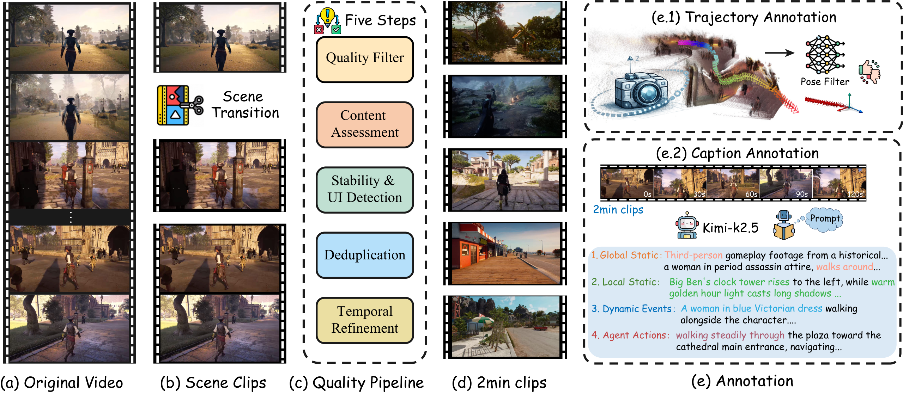

# GameVerse

**GameVerse: A Minute-Scale Gameplay Dataset for Long-Horizon Interactive World Modeling** · NeurIPS 2026

The verified final video selection contains **69,678 clips**, **1,655.05 video hours**, and **349,628,223 encoded frames**. Of these, **40,752 clips** are approximately two minutes long and account for **82.1% of video hours**. Video metadata was checked against the final OCR-pass manifest on October 10, 2026.

## Dataset construction



The figure summarizes scene segmentation, the five-step quality pipeline, clip selection, and trajectory and caption annotation.

## Project website

The project website is in [`website/`](website/). Its layout adapts to desktop, tablet, and phone widths, with resource links and dataset scale near the top. Explore nine attributed recording previews, a complete two-minute clip with seekable keyframes, a separate time-linked structured-caption example, camera trajectory projections, and qualitative generation examples from the paper.

Recording cards distinguish preview length from original clip length. The trajectory overview shows normalized stored camera centers independently of video playback; it does not imply verified timestamp alignment. Generation figures are labeled separately from dataset recordings.

The project website is published at **https://kangverse.github.io/GameVerse/**. Updates to `website/` on `main` automatically deploy through GitHub Pages. The eventual preferred address is https://gameverse.github.io/GameVerse/, pending access to that account or organization.

Preview locally:

```bash
python3 -m http.server 8766 --directory website
```

For public access, open https://kangverse.github.io/GameVerse/ . GitHub Actions is configured as the Pages publishing source.

## Release status

- [Hugging Face dataset](https://huggingface.co/datasets/Kangverse/GameVerse): currently private; public access is forthcoming.
- This GitHub README is the release guide and access entry point; the video dataset itself is not hosted in this Git repository.
- Paper and arXiv links: forthcoming.
- Existing `caption/` files are a legacy annotation snapshot. Full-duration captions are being regenerated; caption-derived distributions are provisional.
- Camera trajectory audit found 69,673 readable pose files and five missing files in the final selection. Exact temporal alignment requires confirmation of the preprocessing timebase. This README does not imply every final clip already has validated released poses and intrinsics.

## Repository contents

- `website/`: public project page, aggregate video statistics, and short recording previews.
- `gameverse_url.txt`: 11,002 distinct collected YouTube URLs; the final selection retains 5,866 distinct source IDs.
- `caption/`: existing structured captions. Use the final release manifest to establish membership; these files alone do not define the final dataset.

## Clip IDs

IDs have the form `<youtube_id>_<start_index>_<end_index>`. The two numerical suffixes should **not** be interpreted as microseconds. Their differences are consistent with source frame counts at nominal 30 or 60 FPS; use explicit video timestamps and the producer metadata for precise time mapping. Caption and pose records can be joined by matching clip IDs when both are available.

## Statistics scope

Video duration is the video-track duration, excluding audio/container padding. Frame counts are encoded video sample counts rather than estimates from hours and a fixed FPS. Two-minute classification uses a 0.05 second tolerance. Historical collection/segmentation-stage quantities and game-title, genre, action, or pose-motion category counts require their own inventories and validated mappings; they are not inferred from final video scale.

The private paper audit, original unpublished LaTeX, full per-clip evidence, and internal paths are maintained separately from this public website repository.
